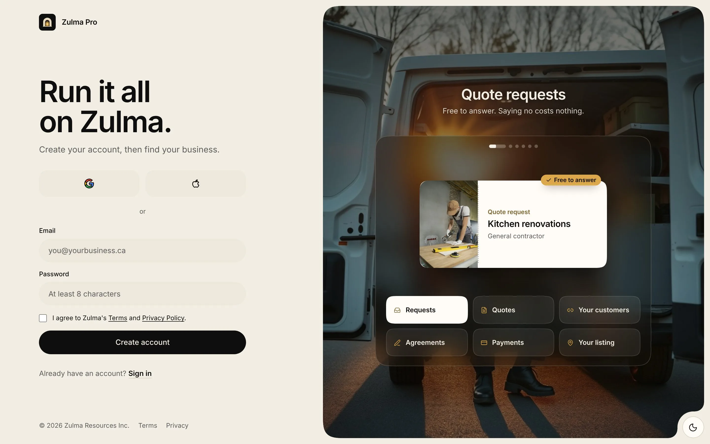
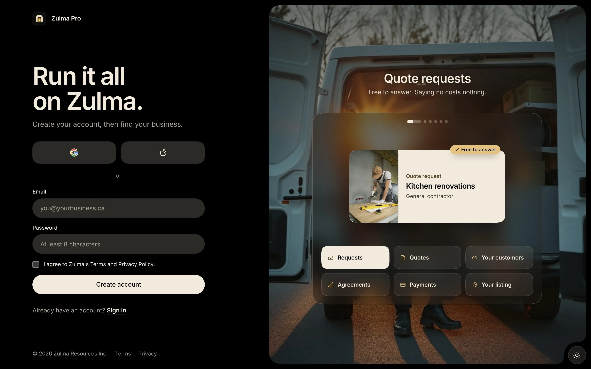

Setting up takes a few minutes. A bar at the top shows where you are: **Your account**, **Your business**, **Terms and plan**, then **Switch on requests**. You can leave and come back. Zulma Pro opens on the step you stopped at.

## Make your account

<Steps>
  <Step title="Open the sign-up page">
    Go to [pro.zulma.ca](https://pro.zulma.ca). Under **New to Zulma Pro?**, select **Create an account**.
  </Step>
  <Step title="Sign up">
    Use Google or Apple, or an email and a password of at least 8 characters. Accept the Terms and Privacy Policy, then select **Create account**.
  </Step>
  <Step title="Say how you work">
    Under **How do you work?**, pick **Just me** or **I have a business**.
  </Step>
</Steps>

<Frame>
  
  
</Frame>

## Just me

For someone who works under their own name. In Ontario, that needs no registration.

1. Tell Zulma **What you do**, the **Town you work from** and, if you like, a **Phone**.
2. Select **Check my ID**. You take a photo of your ID and a selfie. It takes about two minutes.
3. Keep the page open while it checks, usually under a minute.

On Atlas, homeowners see your first name and last initial. Your full name stays private. If you already get Zulma payouts, Stripe knows you, so there is no new check.

## I have a business

For a registered name, a corporation or a team.

1. Select **Find my business** and search for its name or town on **Find your business on Atlas.**
2. Select **This is mine** on your listing. Not there? Select **Add your business**.
3. Prove it is yours. Type the part of your business email before the @ and enter the **Six digit code** Zulma sends. No business email? Select **Send a document** and send a registration, an HST letter or a bill.
4. If you work for the owner, pick your role. You can set everything up and invite the owner to take the owner seat.

If your trade needs a licence in Ontario, you add its number next. See [Get verified](/pro/get-started/get-verified).

## Your business

These details go on your agreements and invoices.

- **Business type**: **Sole proprietor** or **Company or partnership**
- **People who do the work**, counting you
- **Legal name and address**
- **Who signs**: their full name and role
- **GST/HST**: registered or not. If registered, the number as CRA gave it, like 123456789 RT0001

Select **Continue to the terms**.

## Terms and plan

Read the Zulma Pro terms to the end, then type your full name to sign. Select **Sign and start on Free**, or **Sign and add a card** for a paid plan. You can change plans any time after you sign. See [Plans and billing](/pro/team-and-plan/plans-and-billing).

If the owner signs, the terms wait for them. They sign once they take the owner seat from the invite.

## Switch on requests

**Get requests** lists what is left, with a state beside each step: **To do**, **Waiting on review** or **Done**. Finish each one, then switch on quote requests at the end. Select **Decide later** to go to Today and finish another time.
